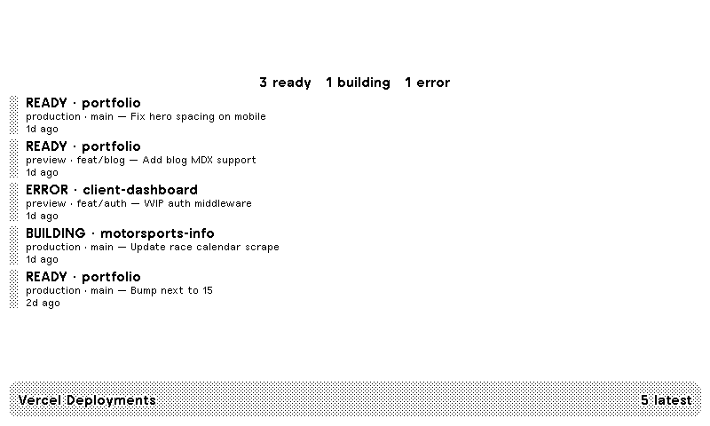

# Vercel Deployments

Latest Vercel deploys on a TRMNL e-ink display: project, state, target, branch, commit message, and relative age.



The screenshot is the full layout rendered from sample data.

## Install

### Import a ZIP in TRMNL

TRMNL imports a flat plugin archive: `settings.yml` at the root of the ZIP, plus the Liquid layouts and `transform.py`. Pack the files in `src/` so `settings.yml` sits at the archive root.

From a clone of this repo:

```sh
cd src
zip ../vercel-deployments-plugin.zip settings.yml *.liquid transform.py
```

In TRMNL, open **Plugins → Private Plugin**, choose **Import new**, and select `vercel-deployments-plugin.zip`. Paste your Vercel token into **Vercel token**. Team ID and project filter are optional. Add the plugin to a playlist.

### Local preview with trmnlp

Install [`trmnlp`](https://github.com/usetrmnl/trmnlp), then from this repo:

```sh
trmnlp serve   # preview at http://localhost:4567
trmnlp login   # once
trmnlp push    # create or update the private plugin
```

`.trmnlp.yml` is committed with an empty `token`. For a live local preview, set `custom_fields.token` on your machine or use trmnlp environment interpolation, then Force Refresh. Leave that value out of git. Without a token the Vercel API returns 403. The `variables` block is sample user data for layout work.

## Create a read-only Vercel token

This plugin only calls `GET /v6/deployments`. Create a personal access token on the [Account tokens](https://vercel.com/account/tokens) page (personal account selected in the dashboard scope switcher, not a team):

1. Name it, for example `TRMNL deployments`.
2. Open **Scope** and pick the smallest set of projects this screen should list.
   - One project: choose its team, then that project.
   - A whole team: choose the team and **All Projects**.
   - Personal projects plus every team: **Full Account**. A full-account token needs the optional **Team ID** (`team_…` from Team Settings → General) when the deployments belong to a team. Team- and project-scoped tokens can leave Team ID blank; Vercel infers the team from the token.
3. Set an expiration and create the token.
4. Copy it when Vercel shows it. The value is shown once and starts with `vcp_`. Paste it only into the plugin's **Vercel token** password field.

Team and Project scopes can still change resources inside that scope, so this is the narrowest access the Account tokens page offers for a read-only deployments screen. Keep the token in the plugin password field. Optional **Project filter** takes a project id or name.

## What it shows

Each row is one deployment from the latest ten: project name, `readyState` (`READY`, `ERROR`, `BUILDING`, and the other Vercel states), target (`production` or `preview`), git branch, commit message (trimmed), and relative age. The full layout also counts ready, building, and error rows.

## API

```
GET https://api.vercel.com/v6/deployments?limit=10&teamId=…&projectId=…
Authorization: Bearer <token>
```

The REST docs also describe `GET /v7/deployments`. This plugin polls v6.

## License

[MIT](LICENSE). Copyright 2026 Alex Baldry.
